# Práctica 4: Detección de vehículos y matrículas, y reconocimiento de caracteres (OCR). Documentación

Autor 1: [Gerad Leopoldo Guzmán Hernández](https://github.com/gerad367)  
Autora 2: [Solmaire Basulto Santana](https://github.com/solbs365)  

---

### 1. Descripción del Trabajo
Este repositorio contiene el cuaderno Jupyter (`P4.ipynb`) con la resolución de la cuarta práctica de Visión por Computador. La práctica tiene dos partes, la 4 (detección) y la 4b (reconocimiento de caracteres), que se entregan juntas, así que las documentamos en este mismo README. El objetivo ha sido construir un prototipo que procese un vídeo, detecte y siga a las personas y los vehículos que aparecen, localice la matrícula de cada vehículo y lea su texto.

Para ello se han combinado cuatro piezas: un YOLO preentrenado para las personas y los vehículos, un detector de matrículas que hemos entrenado nosotros con el dataset UC3M-LP, easyOCR como OCR clásico y SmolVLM2 como modelo de lenguaje visual (VLM).

El trabajo se divide en 2 tareas principales:

- Tarea 1 (práctica 4): Detección y seguimiento de personas y vehículos, y detección de matrículas.
- Tarea 2 (práctica 4b): Lectura del texto de las matrículas y comparativa entre un OCR clásico (easyOCR) y un VLM (SmolVLM2).

No hemos abordado ninguno de los extras opcionales del enunciado (flujo de personas y vehículos por direcciones, comparativa entre YOLO y RT-DETR, detección de matrículas con contornos y anonimización).

**Archivos de la entrega**

| Archivo | Contenido |
| :--- | :--- |
| `P4.ipynb` | Cuaderno con todo el código: entrenamiento, detección y seguimiento, OCR y comparativa |
| `uc3m-lp.yaml` | Rutas del dataset y clase para entrenar el detector de matrículas |
| `results_ocr.csv` | csv completo del vídeo de test (8547 detecciones, fotogramas 1 a 2832) con la columna `text_matrícula` |
| `results.csv` | Muestra del csv con los primeros 103 fotogramas (207 filas) |
| `total.txt` | Total de personas y vehículos contados en el vídeo |
| `plates.txt` | Matrícula de cada una de las 100 imágenes usadas en la comparativa |
| `OCRvcVLM.csv` | Resultado de la comparativa imagen por imagen |
| `entrenamientos/` | `results.csv` y `args.yaml` de cada uno de los 4 entrenamientos del detector |
| `img/` | Imágenes de este README |
| `graficas_entrenamiento.py` | Dibuja la comparativa de los entrenamientos a partir de los `results.csv` de `entrenamientos/` |
| `graficas_ocr.py` | Calcula las métricas y dibuja las gráficas de la comparativa a partir de `OCRvcVLM.csv` |

Por su tamaño no hemos podido subir a GitHub el dataset en formato YOLO (casi 300 MB comprimido), las carpetas `runs` con los pesos entrenados ni los vídeos. Todo eso está en la siguiente carpeta: [Artefactos](https://drive.google.com/drive/folders/19SrdybOELqg3lmdABGIDcE2uSf_Rx5c8?usp=sharing).   
  
El dataset original se descarga desde el repositorio: https://github.com/ramajoballester/UC3M-LP.   
  
De cada entrenamiento hemos subido el `results.csv` y el `args.yaml`, que son con los que analizamos más abajo la evolución del entrenamiento.

### 2. Paquetes necesarios
Se ha usado un environment nuevo con Python 3.9, como se indica en el enunciado (el cuaderno se ha ejecutado con Python 3.9.23):

```
conda create --name VC_P4 python=3.9
conda activate VC_P4
pip install ultralytics lap
pip install easyocr imutils transformers
pip install pandas matplotlib
```

Además hace falta `torch`, que se instala con el comando que da la [web oficial de PyTorch](https://pytorch.org/get-started/locally/) según el equipo y la versión de CUDA. En el código se importan también `cv2`, `numpy`, `math`, `re`, `time` y `PIL`. Los dos scripts de gráficas solo necesitan `pandas`, `numpy` y `matplotlib`.

La versión de Ultralytics tiene que ser reciente: se usan los modelos `yolo26` y el seguidor `tracktrack.yaml`, que según la documentación está disponible a partir de la versión 8.4.63.


### 3. Análisis y Resolución de Tareas

#### Tarea 1: Detección y seguimiento de personas, vehículos y matrículas
Objetivo: procesar el vídeo de test para detectar y seguir a las personas y los vehículos, localizar las matrículas, contar el total de cada clase, volcar un vídeo con los resultados y generar un csv con la detección y el seguimiento.

**Detección y seguimiento de personas y vehículos**

Desarrollo:

Para las personas y los vehículos no hemos entrenado nada. Se usa `yolo26n.pt` preentrenado y se llama a `model.track` en cada fotograma con tres parámetros que importan:

- `persist=True`, para que los identificadores se mantengan de un fotograma al siguiente.
- `classes=[0, 2, 3, 5, 7]`, para quedarnos solo con persona, coche, moto, autobús y camión.
- `tracker="tracktrack.yaml"`, que es uno de los seguidores que incluye Ultralytics.

Elegimos la versión nano porque es la más ligera y en cada fotograma hay que ejecutar también el detector de matrículas. Sobre cada objeto se dibuja su caja con el identificador y la clase, con un color para las personas y otro para los vehículos.

**Detector de matrículas: dataset**

Los modelos de YOLO no incluyen la clase matrícula, así que hubo que entrenar un detector propio. Usamos el dataset [UC3M-LP](https://github.com/ramajoballester/UC3M-LP), un conjunto abierto de matrículas españolas con 1975 imágenes y 2547 matrículas anotadas.

El dataset viene en un formato propio (una imagen y un json por cada una), así que lo pasamos al formato de YOLO con el script `labels2yolo.py` del propio repositorio. Ese script genera dos versiones: una para detectar matrículas sobre la imagen completa (carpeta `LP`) y otra con las matrículas ya recortadas y sus caracteres anotados (carpeta `OCR`). Para el detector usamos la primera:

| Carpeta | Imágenes | Matrículas anotadas |
| :---: | :---: | :---: |
| `LP/images/train` | 1580 | 2056 |
| `LP/images/val` | 395 | 491 |

El archivo `uc3m-lp.yaml` indica las rutas y la única clase:

```
path: ./UC3M-LP-yolo/LP
train: images/train
val: images/val
nc: 1
names: [ 'license plate' ]
```

**Detector de matrículas: entrenamiento**

Entrenamos cuatro detectores con Ultralytics partiendo de pesos preentrenados. En todos solo cambiamos el modelo de partida y el número de épocas, y el resto de parámetros se quedaron con los valores por defecto. Las carpetas de resultados las renombramos a mano según las épocas.

| Entrenamiento | Modelo de partida | Épocas | Tiempo total | Precisión | Recall | mAP50 | mAP50-95 | Uso posterior |
| :---: | :---: | :---: | :---: | :---: | :---: | :---: | :---: | :---: |
| `20epochs` | yolo26n | 20 | 3.4 min | 0.972 | 0.992 | 0.9925 | 0.859 | - |
| `50epochs` | yolo26n | 50 | 11.0 min | 0.985 | 0.986 | 0.9929 | 0.869 | Vídeo sin OCR |
| `100epochs` | yolo26n | 100 | 16.5 min | 0.981 | 0.988 | 0.9933 | 0.878 | Vídeo con OCR y comparativa |
| `70epochsX` | yolo26x | 70 | 138.0 min | 0.989 | 0.996 | 0.9937 | 0.906 | - |

Las métricas son las de la última época sobre el conjunto de validación (`images/val`, 395 imágenes y 491 matrículas) y el tiempo es el acumulado que guarda Ultralytics en el `results.csv`. Se pueden reproducir con `python graficas_entrenamiento.py`.

| Pérdidas y métricas por época (yolo26n, 100 épocas) | Comparativa de los cuatro entrenamientos |
| :---: | :---: |
| 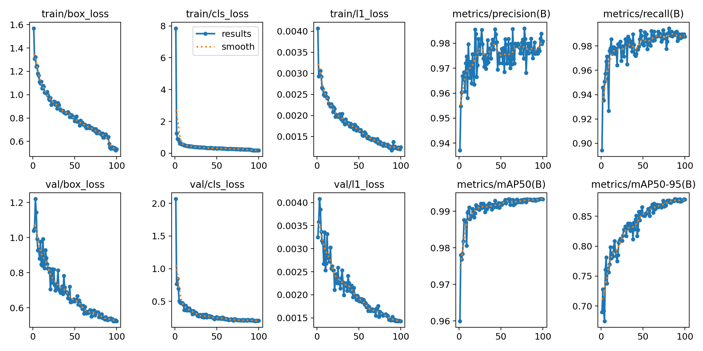 | 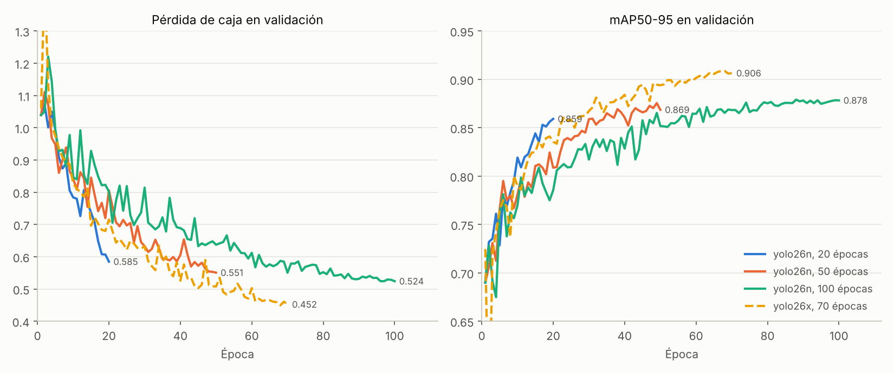 |

| Matriz de confusión | Curva precisión-recall | Curva F1-confianza |
| :---: | :---: | :---: |
| 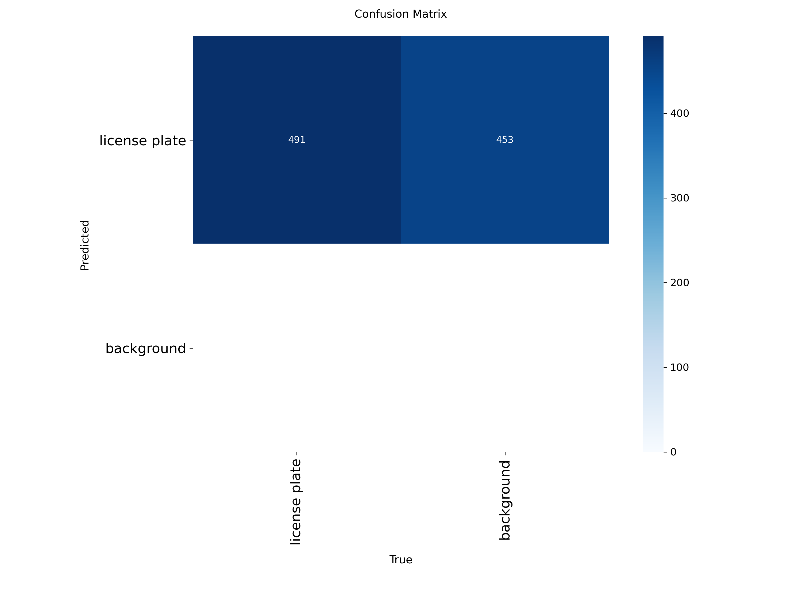 | 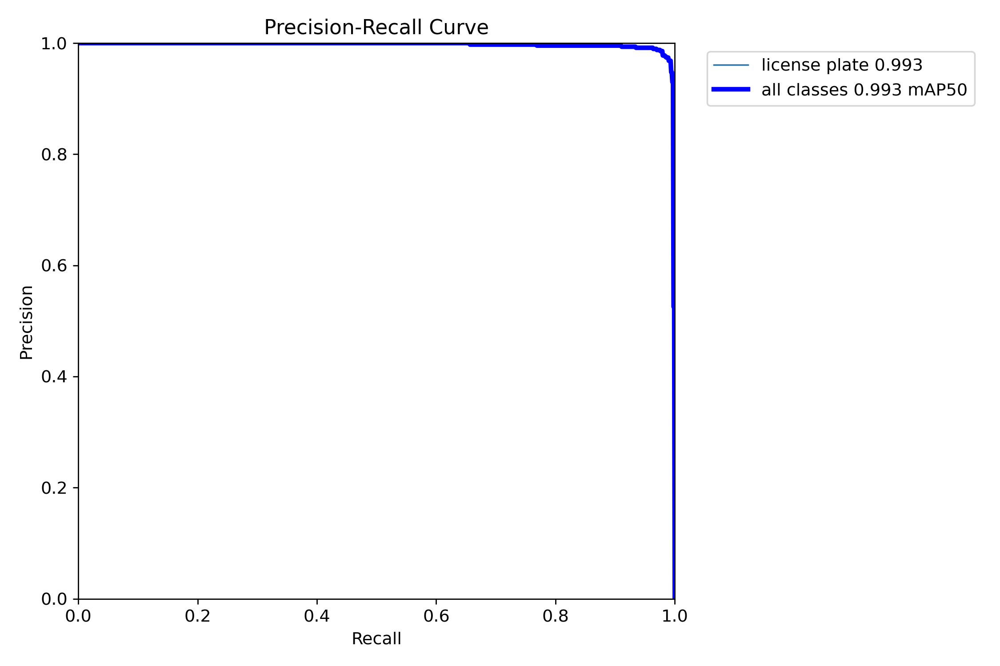 | 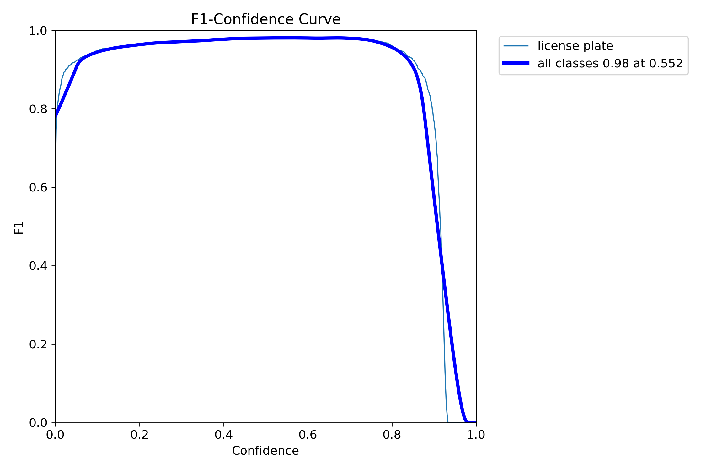 |

| Predicciones sobre imágenes de validación (yolo26n, 100 épocas) |
| :---: |
| 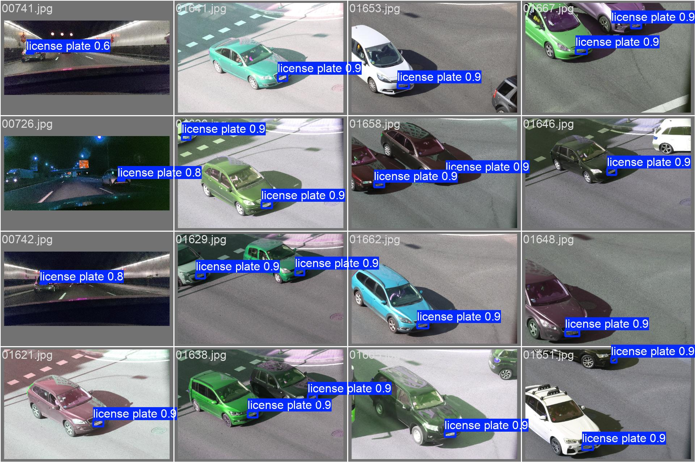 |

Análisis:

*Evolución de las pérdidas.* En el entrenamiento de 100 épocas las pérdidas de entrenamiento y de validación bajan a la vez durante todo el proceso. La pérdida de caja pasa de 1.57 a 0.53 en entrenamiento y de 1.04 a 0.52 en validación, y la de clasificación de 7.85 a 0.19 y de 2.07 a 0.20. Al final las dos curvas casi se tocan (0.534 frente a 0.524 en la caja), así que no vemos señales de sobreajuste. En las últimas épocas la pérdida de validación baja ya muy despacio. En la época 91 se ve un salto hacia abajo de la pérdida de entrenamiento (de 0.639 a 0.578), que coincide con las últimas 10 épocas, en las que Ultralytics desactiva el aumento por mosaico (`close_mosaic=10`).

*Evolución de las métricas.* El mAP50 ya es de 0.96 en la primera época y termina en 0.993. Es decir, con un IoU de 0.5 el detector funciona bien casi desde el principio, algo esperable porque partimos de pesos preentrenados y la matrícula es un objeto fácil de localizar en este dataset. Donde se nota el entrenamiento es en el mAP50-95, que exige cajas más ajustadas: sube de 0.69 a 0.878 y todavía crecía despacio al terminar. La precisión y el recall se estabilizan en torno a 0.98 y 0.99 pasadas las primeras épocas.

*Comparación entre entrenamientos.* Con 20, 50 y 100 épocas el mAP50 es casi idéntico (0.9925, 0.9929 y 0.9933) y la diferencia está en el mAP50-95 (0.859, 0.869 y 0.878): entrenar más ajusta mejor la caja, pero cada vez se gana menos. Las curvas no se pueden comparar época a época, porque la tasa de aprendizaje baja de forma lineal hasta la última época prevista y un entrenamiento corto la baja antes. Por eso en la gráfica el de 20 épocas tiene menos pérdida que el de 100 en las mismas épocas. El modelo grande (`yolo26x`) llega a un mAP50-95 de 0.906 y mejora un poco la precisión y el recall, pero tardó 138 minutos frente a 16.5 del nano de 100 épocas (unos 118 segundos por época frente a 10) y sus pesos ocupan 118 MB frente a 5.5 MB. Como en cada fotograma del vídeo se ejecutan dos modelos, nos quedamos con el nano de 100 épocas para el vídeo con OCR y la comparativa. Las curvas del `yolo26x` están en el desplegable de abajo.

*Matriz de confusión, PR y F1.* La matriz detecta las 491 matrículas de validación (la casilla de matrículas sin detectar está vacía) y marca además 453 predicciones sobre el fondo. Esa cifra llama la atención con una precisión de 0.98. Creemos que se debe a que la matriz incluye detecciones de confianza muy baja, pero no lo hemos comprobado. La curva precisión-recall da un AP50 de 0.993 y la curva F1 tiene su máximo (0.98) con una confianza de 0.552, siendo bastante plana entre 0.1 y 0.8. En el vídeo usamos el umbral por defecto (0.25), que cae dentro de esa zona plana.

*Limitación.* No hemos separado un conjunto de test: el `images/val` es el que usa Ultralytics para elegir el mejor modelo y el que usamos para dar estas métricas, así que son algo optimistas. La prueba real es el vídeo, que tiene otras condiciones (más abajo).

<details>
<summary>Curvas del entrenamiento del yolo26x (70 épocas)</summary>

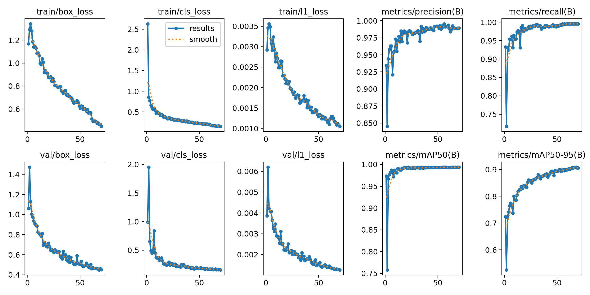

</details>

**Unión de todo en el bucle de vídeo**

El bucle lee el vídeo con `cv2.VideoCapture` y en cada fotograma hace lo siguiente:

1. Ejecuta el seguimiento de personas y vehículos con el modelo nano.
2. Ejecuta el detector de matrículas sobre el fotograma completo (no sobre el recorte de cada vehículo), con los parámetros por defecto.
3. Para cada vehículo (todo lo que no es persona) busca una matrícula cuya caja quede completamente dentro de la caja del vehículo. Si hay varias, se queda con la primera. Si la encuentra, la dibuja con la etiqueta `identificador plate`.
4. Escribe una línea en el csv por cada objeto detectado y guarda el fotograma en el vídeo de salida (`cv2.VideoWriter`, con el mismo tamaño y fps que el original).

En la primera versión (vídeo sin OCR) el detector de matrículas es el de 50 épocas, y en la versión con OCR el de 100 épocas.

El csv sigue el formato sugerido en el enunciado, con `;` como separador:

```
fotograma;tipo_objeto;confianza;identificador_tracking;x1;y1;x2;y2;matrícula_en_su_caso;confianza;mx1;my1;mx2;my2;text_matrícula
```

Para las personas, y para los vehículos en los que no se ha encontrado matrícula, los campos de la matrícula llevan `false` y `null`. Las dos columnas `confianza` son la del objeto y la de la matrícula, en ese orden. La última columna (`text_matrícula`) se rellena en la tarea 2.

Para contar el total de cada clase se guarda, para cada identificador de seguimiento, la clase del objeto (`track_history`). Al terminar el vídeo se cuenta cuántos identificadores hay de cada clase y se escribe en `total.txt`.

| Fotograma del vídeo de test con los resultados | Matrículas detectadas |
| :---: | :---: |
| 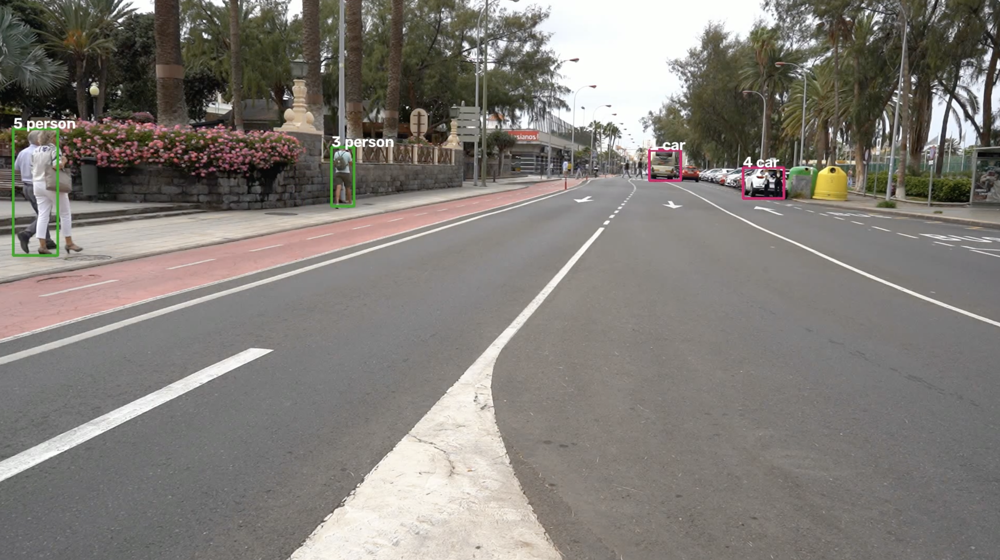 | 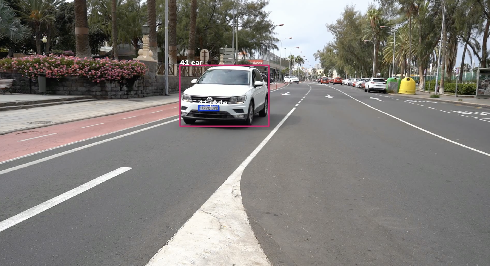 |


**Resultados sobre el vídeo de test**

Estos datos salen de analizar el `results_ocr.csv` con `pandas`:

| Dato | Valor |
| :--- | :---: |
| Fotogramas del vídeo | 2832 (los fotogramas 956 y 957 no tienen ninguna detección) |
| Filas en el csv | 8547 (5585 coches, 2682 personas, 215 autobuses, 52 camiones y 13 motos) |
| Identificadores de seguimiento distintos | 49 |
| Filas sin identificador | 347 |
| Filas de vehículo con matrícula detectada | 1295 de 5865 (22.1 %) |
| Vehículos con matrícula detectada al menos una vez | 29 de 36 |
| Confianza de la matrícula (media / mediana) | 0.67 / 0.72 |
| Tamaño típico de la caja de la matrícula (mediana, ancho x alto) | 52 x 13 píxeles |

El total que se escribe en `total.txt` es:

| Clase | Total |
| :---: | :---: |
| Personas | 13 |
| Coches | 34 |
| Motos | 1 |
| Camiones | 1 |

Estos totales hay que leerlos con cuidado por el problema de las clases que se explica a continuación.

Problemas:

Al analizar el csv nos encontramos con varias limitaciones:

- **La clase de un mismo identificador cambia.** De los 49 identificadores, 6 aparecen con más de una clase a lo largo del vídeo, y en `track_history` se guarda la última clase que ve el detector, que es la que cuenta en el total. El identificador 1 es un autobús: aparece como autobús en 215 fotogramas, como coche en 69 y como camión en 26, pero como lo último que ve es coche, se cuenta como coche y no sale ningún autobús. El 36 es una persona en 161 fotogramas y un coche en 16, y se cuenta como coche. El 37 es un coche en 67 fotogramas y un camión en 15, y acaba contado como el único camión. Si en lugar de la última clase se usara la más frecuente de cada identificador, el total sería de 14 personas, 33 coches, 1 moto y 1 autobús, que nos parece más fiable porque no depende de lo que detecte el modelo en el último fotograma.

- **Detecciones sin identificador.** 347 filas (314 de coches, 32 de personas y 1 de camión) no tienen identificador de seguimiento en ese fotograma. Esas filas no cuentan en el total, aunque el mismo objeto sí puede tener identificador en otros fotogramas.

- **La matrícula solo se detecta en el 22 % de las filas de vehículo.** Las cajas de las matrículas son muy pequeñas en el vídeo (la mediana mide unos 52 x 13 píxeles) y, además, el detector se ha entrenado con las imágenes de UC3M-LP, que son distintas de las del vídeo de test. Se nota que las métricas de validación no se trasladan directamente al vídeo: en la ejecución sin OCR, con el modelo de 50 épocas, salían matrículas en el 31 % de las filas de vehículo, frente al 22 % del modelo de 100 épocas, aunque este último tiene mejor mAP50-95 en validación. No hemos comprobado cuál de los dos acierta más en el vídeo porque no tenemos anotaciones de él.

- **La asociación de matrícula a vehículo es estricta.** Exigimos que la caja de la matrícula esté completamente dentro de la del vehículo, así que si queda justo en el borde o el vehículo está recortado, la matrícula se pierde para ese fotograma. Además solo se guarda la primera que cumple la condición.

- **Velocidad.** En cada fotograma se ejecutan dos modelos y no hemos medido los fotogramas por segundo del procesado completo.

#### Tarea 2: Reconocimiento de los caracteres de las matrículas (práctica 4b)
Objetivo: ampliar el prototipo anterior para que lea el texto de las matrículas detectadas, y comparar un OCR clásico con un modelo de lenguaje visual en tiempo de inferencia y tasa de acierto.

De los OCR clásicos que proponía el enunciado (Tesseract, easyOCR y PaddleOCR) nos quedamos con **easyOCR**, y como VLM usamos **SmolVLM2-2.2B-Instruct** (de HuggingFace), que es una versión más nueva de uno de los modelos ligeros que se sugerían.

**Lectura de la matrícula en el vídeo (easyOCR)**

Desarrollo:

Cuando el detector encuentra una matrícula dentro de un vehículo, se recorta esa zona del fotograma y se pasa por tres pasos antes de guardar el texto en la columna `text_matrícula`:

1. **Preprocesado** (`ocr_preprocess`). Los recortes son muy pequeños y de poco contraste, así que se intenta dejar solo los caracteres en blanco sobre fondo negro:

| Paso | Función de OpenCV |
| :--- | :--- |
| Ampliar el recorte a 1200 x 400 | `cv2.resize` (interpolación cúbica) |
| Pasar a grises y suavizar | `cv2.cvtColor` y `cv2.blur` |
| Umbral adaptativo gaussiano invertido | `cv2.adaptiveThreshold` |
| Transformada de distancia y umbral de Otsu | `cv2.distanceTransform`, `cv2.normalize` y `cv2.threshold` |
| Dilatación, erosión, cierre y filtro de mediana | `cv2.dilate`, `cv2.erode`, `cv2.morphologyEx` y `cv2.medianBlur` |
| Quedarse con los contornos que tienen tamaño de carácter (ancho de 35 a 300 y alto de 100 a 300) y enmascarar con su envolvente convexa | `cv2.findContours` y `cv2.convexHull` |

2. **Lectura con easyOCR.** Se carga el lector con `easyocr.Reader(['es', 'en'])` y se llama a `readtext` limitando los caracteres posibles a las letras mayúsculas y los dígitos (`allowlist`). Los fragmentos de texto que devuelve se concatenan.

3. **Validación del formato.** El texto leído se pasa por una expresión regular (`\d{4}[A-Z]{3}`), que es el formato de las matrículas españolas actuales: cuatro números y tres letras. Se guarda lo que encaja con ese patrón y, si no hay nada que encaje, se escribe `null`.

| Recortes de matrículas tras el preprocesado | Fotograma con la matrícula leída |
| :---: | :---: |
|  |  |


Resultados sobre el vídeo de test:

De las 1295 filas con matrícula detectada, el `text_matrícula` queda así:

| Texto en el csv | Filas | Qué significa |
| :--- | :---: | :--- |
| Matrícula válida | 155 (12.0 %) | easyOCR devolvió texto con formato de matrícula |
| `null` | 949 | easyOCR devolvió texto, pero no cumplía el formato |
| `null` (corregida) | 191 | easyOCR no devolvió nada, y en el csv original esas filas se quedaban sin la última columna |

Solo 13 de los 29 vehículos con matrícula detectada tienen alguna lectura válida. Las 155 lecturas son 90 textos distintos, porque el mismo coche se lee de forma un poco distinta en cada fotograma (se hace una lectura por fotograma, sin combinarlas). Esta tabla resume, para cada uno de esos 13 vehículos, cuántas lecturas válidas tiene y cuál es la más frecuente:

| Identificador | Lecturas válidas | Lectura más frecuente | Veces |
| :---: | :---: | :---: | :---: |
| 8 | 19 | 3713LXC | 10 |
| 12 | 4 | 0248VFF | 1 |
| 19 | 3 | 7316FGY | 1 |
| 23 | 9 | 0053JFY | 4 |
| 24 | 5 | 2216PZI | 2 |
| 26 | 11 | 0285FKZ | 3 |
| 31 | 7 | 1202FIC | 1 |
| 33 | 13 | 3655KIV | 2 |
| 35 | 12 | 8536LKJ | 5 |
| 37 | 4 | 5555LTR | 1 |
| 40 | 34 | 1770JYG | 30 |
| 44 | 11 | 6082JYV | 1 |
| 48 | 23 | 1965KEP | 6 |

Solo el identificador 40 se lee de forma estable (30 de 34 lecturas son iguales). En el 8 la lectura más frecuente aparece en algo más de la mitad de las lecturas (10 de 19) y en el 48 en una cuarta parte (6 de 23), y las demás difieren en uno o dos caracteres (por ejemplo `3713LXC` y `3713LKC`). En el resto, la lectura más frecuente aparece pocas veces (entre 1 y 5). Esta tabla no está en el csv, solo la hemos calculado para el README.

> **PENDIENTE:** como no tenemos las matrículas reales del vídeo, estas lecturas no se han podido evaluar con una métrica. Comprobar a ojo en el vídeo al menos las de los identificadores 40, 8 y 48 y escribir aquí si coinciden con la matrícula que se ve.

**Comparativa entre easyOCR y SmolVLM2**

Desarrollo:

La comparativa está en las últimas celdas del cuaderno. Para que las condiciones fueran las mismas para los dos modelos:

- Se usan **100 imágenes** del dataset UC3M-LP (de la carpeta `images/train`, desde la `00023.jpg` hasta la `00194.jpg`). La matrícula de cada una está en `plates.txt`. En 99 de ellas hay una sola matrícula anotada y en la `00167` hay tres, y en esa nos quedamos con la primera detección, que puede no ser la que figura en `plates.txt`.
- En cada imagen se localiza la matrícula con el detector entrenado (`100epochs`), quedándose con la primera detección con confianza mayor de 0.7. **Los dos modelos reciben exactamente el mismo recorte**, sin preprocesado. (El preprocesado de la tarea anterior solo se aplica a easyOCR en la comparativa si se activa `SHOW_IMAGES`, y en las ejecuciones que presentamos estaba desactivado.) En las 100 imágenes se encontró una matrícula.
- **easyOCR**: `Reader(['es', 'en'])` y `readtext` con la misma lista de caracteres permitidos que en el vídeo, sin la expresión regular.
- **SmolVLM2-2.2B-Instruct**: cargado en `bfloat16` sobre la GPU, con el mensaje *"Concatenate and return every character"* junto al recorte y un máximo de 10 tokens generados (`max_new_tokens=10`). Como la respuesta incluye el texto de la conversación, nos quedamos con su última palabra.
- El **tiempo de inferencia** se mide con `time.time()` justo alrededor de la llamada a cada modelo, e incluye el procesado de la entrada, pero no la carga del modelo.
- La **tasa de acierto** cuenta como acierto que el texto coincida exactamente con la matrícula. Con el csv (`OCRvcVLM.csv`) calculamos además, en `graficas_ocr.py`, las lecturas con a lo sumo un carácter de error (distancia de Levenshtein), las que tienen la longitud correcta, las lecturas vacías y la tasa de error por carácter (CER, la suma de las distancias de Levenshtein dividida entre el total de caracteres reales).

Una particularidad del dataset condiciona esta comparativa: **todas las matrículas de UC3M-LP tienen dos caracteres tapados con un recuadro gris** (para anonimizarlas). En los nombres de los archivos de la carpeta `OCR` esos caracteres aparecen como asteriscos, por ejemplo `00023_AD-0*54*PX`. Las matrículas de `plates.txt` son esos nombres sin los asteriscos, y por eso tienen 5 caracteres (tres números y dos letras) en lugar de los 7 de una matrícula española. Lo comprobamos en las 100 imágenes y coinciden todas. Es decir, para acertar de forma exacta un modelo tiene que leer los 5 caracteres visibles y además ignorar los recuadros grises.

| Recorte de ejemplo (`00023`, matrícula `054PX`) |
| :---: |
| 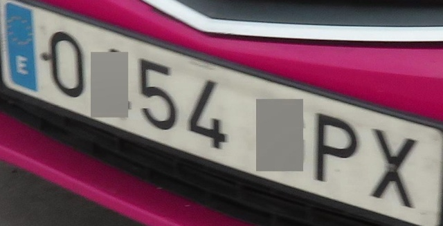 |

*El recorte es el de la carpeta `OCR` del dataset, no el que saca nuestro detector, pero tiene los mismos recuadros grises.*

Equipo en el que se han hecho las pruebas (los tiempos dependen mucho de él):

| Componente | Valor |
| :--- | :--- |
| Sistema operativo | Linux |
| Procesador | **PENDIENTE** |
| Memoria RAM | **PENDIENTE** |
| GPU (indicar también si easyOCR se ejecutó en GPU) | **PENDIENTE** |
| Python | 3.9.23 |

Resultados:

| Modelo | Aciertos exactos | A lo sumo 1 error | Longitud correcta | Lecturas vacías | CER | Tiempo medio | Tiempo mediano |
| :--- | :---: | :---: | :---: | :---: | :---: | :---: | :---: |
| SmolVLM2-2.2B | 10 / 100 | 29 / 100 | 32 / 100 | 0 / 100 | 0.60 | 0.763 s | 0.619 s |
| easyOCR | 10 / 100 | 22 / 100 | 13 / 100 | 58 / 100 | 0.72 | 0.0063 s | 0.0025 s |

| Rendimiento | Tiempos de inferencia |
| :---: | :---: |
| 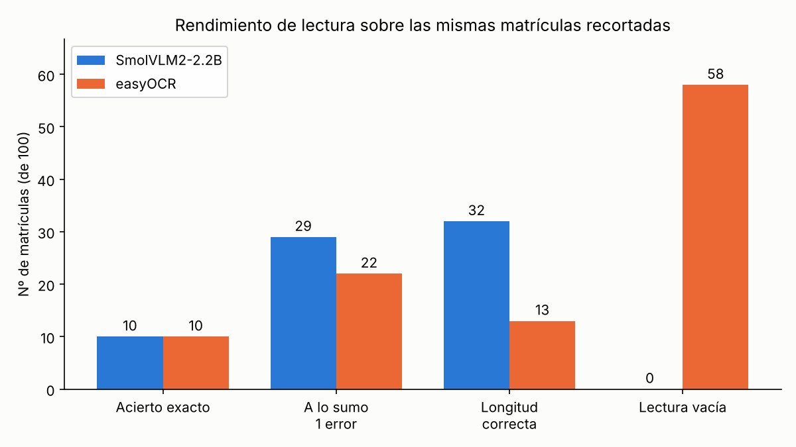 | 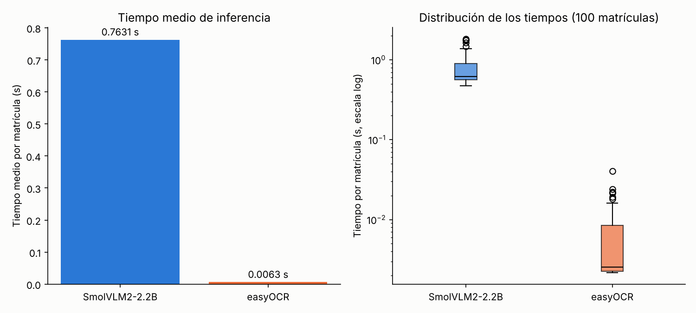 |

Algunos ejemplos de lo que devuelve cada modelo:

| Matrícula real | SmolVLM2 | easyOCR |
| :---: | :---: | :---: |
| 948FC | 948FC | 948LFC |
| 054PX | 054PX | PX103L |
| 891RZ | 8911RZ | 891RZ |
| 316VX | 316WXX | 316VX |
| 736DT | 736 | 736DT |
| 222WR | 222222222 | 2202 |
| 496TM | ming | (vacío) |
| 961MV | 101010101 | (vacío) |

Conclusiones:

- **En acierto exacto están empatados**, con 10 matrículas de 100 cada uno, y no son las mismas: solo 2 las aciertan los dos a la vez y hay 18 que acierta al menos uno. Es una tasa muy baja para los dos, y hay que tener en cuenta que el criterio es exigente por los caracteres tapados del dataset, que afectan por igual a los dos modelos.

- **El VLM es mucho más lento.** Tarda de media 0.76 s por matrícula frente a 0.0063 s de easyOCR, es decir, unas 120 veces más. La primera imagen es más lenta en los dos (1.63 s y 0.04 s) por el calentamiento. En el caso de easyOCR hay que tener en cuenta que el tiempo mediano (0.0025 s) está bajado por las lecturas vacías, que terminan casi al instante. Si solo se cuentan las lecturas con texto, la media sube a 0.0105 s, y sigue siendo unas 70 veces más rápido.

- **Los errores son de tipo distinto.** easyOCR no lee nada en 58 de las 100 matrículas, pero cuando sí devuelve texto (42 veces), en 22 se equivoca como mucho en un carácter. SmolVLM2 siempre contesta algo, y por eso tiene mejor CER y más lecturas con la longitud correcta o con un solo error, pero a menudo se inventa el resultado: repite dígitos (`222222222`, `101010101`), añade caracteres (`8911RZ`), corta la matrícula (`736`) o devuelve palabras sueltas (`ming`). El CER de easyOCR está muy penalizado por las lecturas vacías, que cuentan como cinco errores cada una.

- **Para el vídeo nos quedamos con easyOCR.** Con el VLM, cada lectura añadiría casi un segundo, y en nuestro vídeo hay 1295 filas con matrícula detectada, que a 0.76 s cada una son unos 16 minutos solo de lectura. Lo mejor del VLM es que no se queda sin responder, pero con estos resultados no compensa el tiempo.

Problemas:

- **Los recortes son muy pequeños.** Es el principal problema de los dos modelos. Durante la comparativa, `transformers` avisó al menos cuatro veces de recortes de apenas 4 píxeles de alto (y de 14 a 18 de ancho), y en el vídeo la caja mediana de la matrícula mide 52 x 13 píxeles. Creemos que gran parte de los fallos (sobre todo las lecturas vacías de easyOCR) se deben a eso y no tanto al modelo, pero no hemos probado a ampliar los recortes para comprobarlo.

- **Caracteres tapados en las imágenes.** Los recuadros grises del dataset pueden confundir a los modelos (por ejemplo, leerlos como un dígito o una letra) y hacen que la comparativa no sea con matrículas completas. Tampoco hemos podido usar en ella la expresión regular del vídeo, porque esta busca matrículas de 7 caracteres y las de `plates.txt` tienen 5.

- **easyOCR sin preprocesado en la comparativa.** En el vídeo easyOCR recibe el recorte preprocesado, pero en la comparativa recibe el recorte tal cual, de modo que los dos modelos parten de la misma imagen. Por eso los resultados de easyOCR en el vídeo y en la comparativa no son directamente comparables.

- **Las imágenes son de entrenamiento del detector.** Las 100 imágenes salen de `images/train`, que son las que vio el detector de matrículas al entrenar. Esto puede favorecer un poco el recorte, pero no afecta al reconocimiento, porque ni easyOCR ni SmolVLM2 se han entrenado con ellas.

- **Una sola lectura por fotograma.** Leemos la matrícula de cada vehículo en cada fotograma de forma independiente, sin combinar las lecturas de un mismo identificador a lo largo del vídeo. Con una votación entre fotogramas se corregirían muchos errores sueltos (como los de la tabla de arriba), pero no la hemos implementado.

#### Vídeo de test procesado

https://drive.google.com/drive/folders/19SrdybOELqg3lmdABGIDcE2uSf_Rx5c8

### 4. Bibliografía y Fuentes Consultadas

- [UC3M-LP: UC3M License Plate detection and recognition dataset](https://github.com/ramajoballester/UC3M-LP)
- [Ramajo-Ballester, Armingol Moreno y de la Escalera Hueso. Dual license plate recognition and visual features encoding for vehicle identification. Robotics and Autonomous Systems, 172, 2024](https://doi.org/10.1016/j.robot.2023.104608)
- [Ultralytics: modo Track (seguidores BoT-SORT, ByteTrack y TrackTrack)](https://docs.ultralytics.com/modes/track/)
- [Ultralytics: modo Train](https://docs.ultralytics.com/modes/train/)
- [EasyOCR](https://github.com/JaidedAI/EasyOCR)
- [SmolVLM2-2.2B-Instruct (HuggingFace)](https://huggingface.co/HuggingFaceTB/SmolVLM2-2.2B-Instruct)
- [HuggingFace Transformers](https://huggingface.co/docs/transformers)
- [OpenCV: Structural Analysis and Shape Descriptors](https://docs.opencv.org/4.x/d3/dc0/group__imgproc__shape.html)
