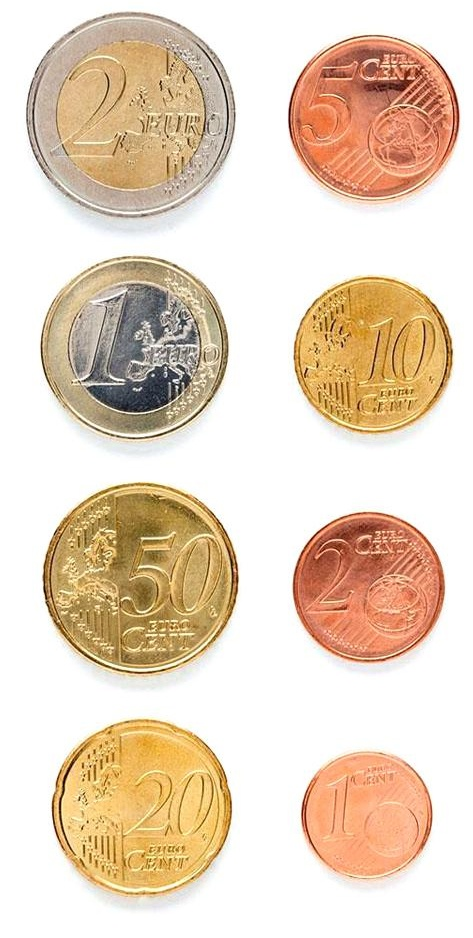
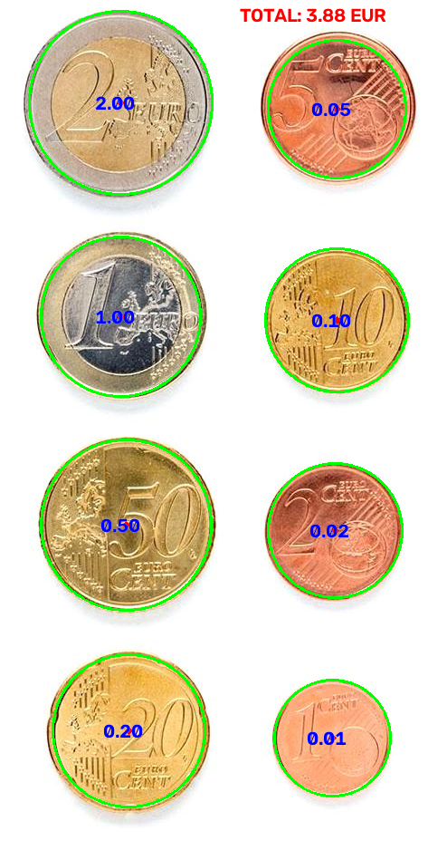
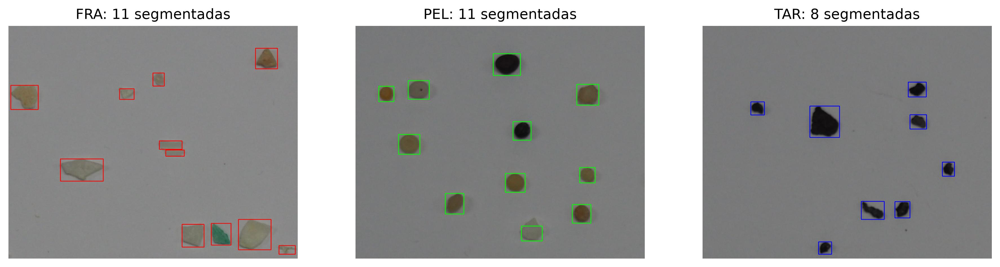
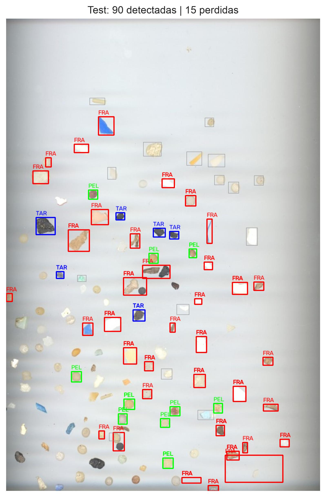
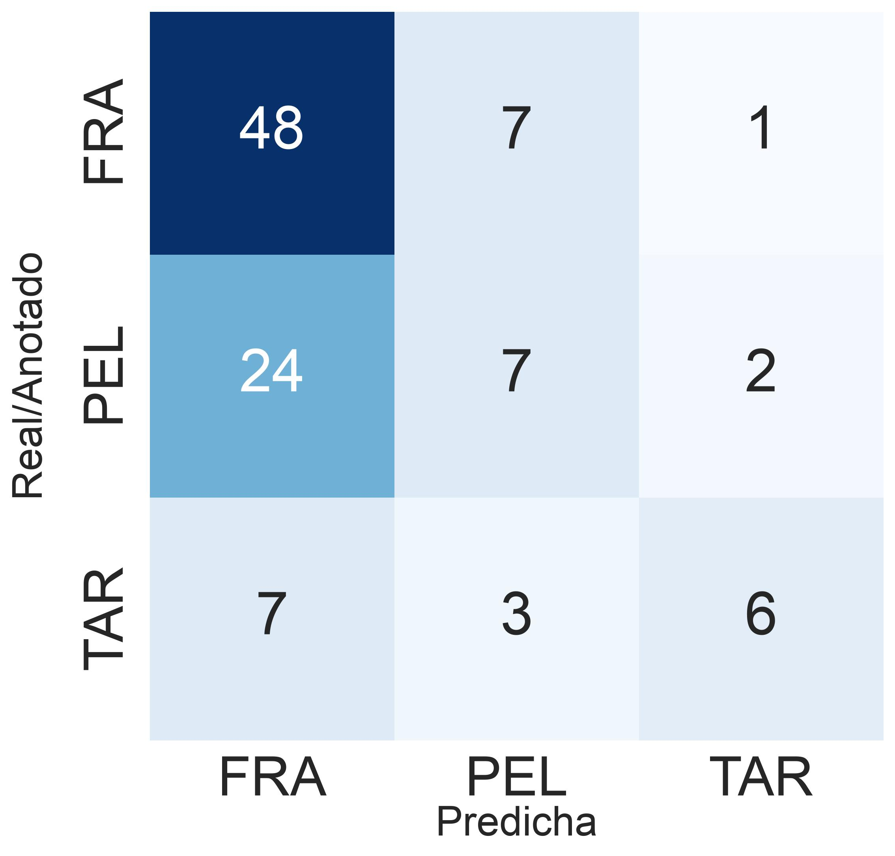
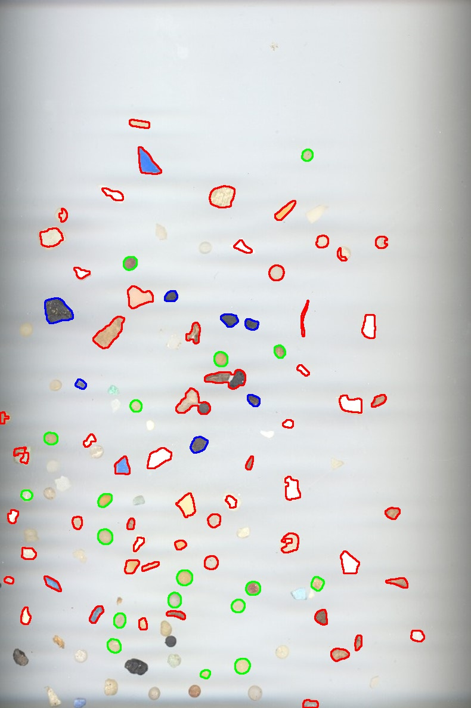

# Práctica 3: Detección y reconocimiento de formas. Documentación

Autora 1: [Solmaire Basulto Santana](https://github.com/solbs365)  
Autor 2: [Gerad Leopoldo Guzmán Hernández](https://github.com/gerad367)

---

### 1. Descripción del Trabajo
Este repositorio contiene el cuaderno Jupyter con la resolución de las tareas de la tercera práctica de Visión por Computador. El objetivo ha sido sacar información geométrica de los objetos que aparecen en una imagen (área, perímetro, forma del contorno...) para poder caracterizarlos y reconocerlos después de forma automática. Para ello se ha trabajado con el umbralizado, la detección de contornos y la transformada de Hough, y en ninguna de las tareas se ha usado aprendizaje profundo.

El trabajo se divide en 2 tareas principales:

- Tarea 1: Contador de dinero con monedas (imagen ideal y demostrador en vivo).
- Tarea 2: Clasificación de microplásticos (fragmentos, pellets y alquitrán).

### 2. Paquetes necesarios
Se puede usar el mismo environment de las prácticas anteriores. Lo único nuevo son `scikit-learn` y `seaborn`, que se usan para calcular las métricas y dibujar la matriz de confusión:

```
pip install scikit-learn seaborn
```

Además se importan `cv2`, `numpy`, `matplotlib`, `pandas`, `csv` y `math`.

*Nota:* Igual que en la práctica anterior, el código incluye `cv2.waitKey(1)` después de `cv2.destroyAllWindows()` para evitar el cuelgue del kernel en Mac.

### 3. Análisis y Resolución de Tareas

#### Tarea 1: Contador de monedas
Objetivo: calcular la cantidad de dinero que hay en una imagen de monedas. Primero con la imagen ideal que se proporciona (`Monedas.jpg`) y después en vivo con la cámara web.

**Imagen ideal**

Desarrollo:

Se partió de lo que sugiere el enunciado: si se sabe lo que mide una moneda en la realidad, se puede sacar la relación píxeles/milímetros y con ella el tamaño real de todas las demás.

Primero se localizan las monedas con la transformada de Hough (`cv2.HoughCircles`) sobre la imagen en grises suavizada con `cv2.medianBlur`, y se dibujan los círculos encontrados. Luego, con `cv2.setMouseCallback`, se hace clic sobre la moneda de 1€ y se busca qué círculo contiene el punto pulsado (con Pitágoras, comprobando que la distancia al centro es menor que el radio). El diámetro de esa moneda en píxeles junto con sus 23.25 mm reales da la relación `pix_to_mm`. A partir de ahí, cada círculo se pasa a milímetros y se le asigna la moneda de la tabla `coin_size` cuyo diámetro se parece más.

Un detalle: en el enunciado el diámetro de la moneda de 50 céntimos aparece como 24.35 mm, pero el valor real es 24.25 mm, que es el que usamos en la tabla.

Primer intento y problema:

En la primera versión el diámetro se calculaba directamente con el radio que devuelve Hough (`radius * 2`). El resultado fue que tres monedas se clasificaban mal, y la de 2 céntimos era una de ellas:

| Moneda real | Diámetro real (mm) | Medido con Hough (mm) | Clasificada como |
| :---: | :---: | :---: | :---: |
| 5 cts | 21.25 | 20.08 | 10 cts |
| 10 cts | 19.75 | 20.87 | 5 cts |
| 2 cts | 18.75 | 19.55 | 10 cts |

El total salía 3.96€ cuando en la imagen hay 3.88€. Se parecía solo porque unos errores compensaban a otros.

Mirando los números nos dimos cuenta de que el radio que da Hough no es nada preciso. Por ejemplo, la moneda de 10 cts salía más grande que la de 5 cts (radios de 79.3 y 76.2 píxeles) cuando en la realidad es justo al revés. Las monedas tienen varios bordes (el canto, el aro interior, la sombra) y Hough se puede quedar con cualquiera de ellos. Además, como todo se calibra con la moneda de 1€, si su radio sale un poco pequeño todas las demás salen infladas. La de 2 cts es la que más lo sufre, porque solo hay 1 mm de diferencia con la de 10 cts.

Solución:

Se dejó Hough solo para saber **dónde** está cada moneda, y el tamaño se pasó a medir con el contorno. Como en la imagen ideal el fondo es blanco, se umbraliza la imagen en grises (`cv2.threshold` con 200 y `THRESH_BINARY_INV`), de forma que todo lo que es más oscuro es moneda. Después se hace un cierre morfológico (`cv2.morphologyEx`) y se sacan los contornos externos con `cv2.findContours`.

La función `measure_diameter` busca el contorno que contiene el centro del círculo de Hough (`cv2.pointPolygonTest`) y calcula el diámetro a partir de su área: `d = sqrt(4 * A / π)`. Como el área sale de muchos píxeles, el error es mucho menor que con el radio de Hough. Con este cambio las 8 monedas se clasifican bien y el total es 3.88€.

| Círculos detectados con Hough | Salida final |
| :---: | :---: |
|  |  |

  
**Demostrador en vivo**

Desarrollo:

El demostrador usa la misma idea (relación píxeles/mm calibrada con la moneda de 1€), pero la forma de encontrar las monedas es distinta. En una escena real hay más cosas que las monedas (la mesa, el borde del folio, otros objetos), así que el bucle de la cámara (`cv2.VideoCapture`) hace tres pasos en cada fotograma:

1. Encontrar el folio. Se suaviza el fotograma en grises (`cv2.medianBlur`), se umbraliza con Otsu y se coge el contorno de mayor área, que es el folio. Ese contorno se simplifica con `cv2.approxPolyDP` hasta que queda como un cuadrilátero y con él se dibuja una máscara de la zona de detección. A la máscara se le pone un borde negro de 20 píxeles para quitar el borde del folio y sus sombras. Así, lo que hay fuera del folio no se tiene en cuenta.  
  
2. Encontrar las monedas dentro del folio. Dentro de esa zona se vuelve a umbralizar con Otsu, esta vez invertido para que las monedas (más oscuras que el folio) salgan en blanco, se hace un cierre morfológico y se sacan los contornos. A cada contorno se le ajusta una elipse con `cv2.fitEllipse`. Se descartan las elipses cuyos dos ejes se diferencian en más de 20 píxeles (no son redondas, así que no son monedas o son monedas pegadas) y las de área menor de 200 píxeles (ruido). El radio de cada moneda sale de la media de los dos ejes.
  
3. Calcular el dinero. Las monedas se guardan en `circ` con el mismo formato que daba Hough (centro y radio), así que `search_clicked_coin` y `count_money` se reutilizan casi igual. Al hacer clic en la moneda de 1€ se calcula `pix_to_mm` y, desde ese momento, el total se recalcula en cada fotograma y se escribe en pantalla con `cv2.putText`.

En esta versión ya no se usa Hough: el diámetro sale directamente de la elipse.

Además se añadió un seguimiento de la moneda de referencia. En cada fotograma se busca la moneda más cercana a la última posición de la moneda de 1€ y con ella se vuelve a calcular `pix_to_mm`. La idea es que la escala se vaya actualizando si la moneda se mueve por el folio o cambia un poco la distancia de la cámara.

Respecto a la versión de la imagen ideal, `count_money` ahora devuelve el total en lugar de imprimirlo (si no, escribía decenas de líneas por segundo en la consola) y comprueba que haya círculos (`circ is not None`).

¿Funciona correctamente? ¿Se observan problemas?

Funciona con el folio bien iluminado y las monedas separadas entre sí. Los problemas que tiene el método son:

- Depende de que el folio se distinga bien de la mesa. Si no hay contraste, Otsu no lo separa y la zona de detección sale mal.

- Las monedas también se separan con un umbral de Otsu para toda la imagen, así que una moneda muy clara (dorada o plateada con mucho brillo) puede quedar por encima del umbral y no detectarse.

- Los objetos que no son redondos se descartan con el filtro de la elipse, pero un objeto redondo (una chapa, por ejemplo) se cuenta como la moneda que más se le parezca, porque `min_diference` empieza en 1000.

- Las monedas solapadas no se cuentan: al juntarse forman un contorno que no es redondo y se descarta. No suma de más, pero su valor no aparece.

- El seguimiento siempre se queda con la moneda más cercana a la posición anterior. Si se retira la de 1€, se recalibra con otra moneda como si fuera de 1€ y el total sale mal.


#### Demostración de uso

https://github.com/user-attachments/assets/717124f9-7895-4717-ab6b-e7ede48aff07

#### Tarea 2: Clasificación de microplásticos
Objetivo: extraer las partículas de una imagen de test (`MPs_test.jpg`) y clasificarlas en tres clases: fragmentos (FRA), pellets (PEL) y alquitrán (TAR). Solo se pueden usar las imágenes de entrenamiento para construir el clasificador, la imagen de test se usa únicamente para evaluar con sus anotaciones (`MPs_test_bbs.csv`). No se usa aprendizaje profundo ni para segmentar ni para clasificar.

Desarrollo:

El procedimiento tiene cuatro partes: segmentar, calcular características, clasificar y evaluar.

**1. Segmentación**

Según el enunciado, el umbralizado es delicado para separar las partículas del fondo, así que se intentó no depender de un único valor de gris:

- Se suaviza la imagen con `cv2.GaussianBlur`.

- Se estima el fondo con una mediana muy grande (`cv2.medianBlur` con tamaño 31 sobre la imagen reducida al 10 %). Así se compensa que la luz no sea uniforme y las partículas no cuentan como fondo.

- Se calcula la diferencia con el fondo (`cv2.absdiff`) y se coge la mayor entre los tres canales de color. De esta forma se detecta una partícula tanto si es más clara, más oscura o simplemente de otro color que el fondo.

- Se umbraliza esa diferencia con Otsu, pero limitando el valor entre 10 y 25. Sin ese límite, Otsu se deja llevar por el alquitrán, que es muy oscuro, y se pierden las partículas claras.

- Se limpia con una apertura y un cierre morfológicos, se sacan los contornos externos (`cv2.RETR_EXTERNAL`) y se descartan los de menos de 100 píxeles de área, que son ruido.

**2. Características**

Para cada contorno se calculan las características geométricas del artículo SMACC, más dos de apariencia:

| Característica | Cómo se calcula |
| :--- | :--- |
| Área y perímetro | `cv2.contourArea` y `cv2.arcLength` |
| Compacidad | perímetro² / área |
| Relación con el contenedor | área de la partícula / área del rectángulo de área mínima (`cv2.minAreaRect`) |
| Relación ancho/alto | lado corto / lado largo de ese rectángulo |
| Relación de ejes de la elipse | eje menor / eje mayor de `cv2.fitEllipse` |
| Relación de distancias | distancia mínima / máxima del centroide (`cv2.moments`) al contorno |
| Brillo y saturación | media dentro de la partícula en gris y en el canal S de HSV |

Se usó el rectángulo girado y no el vertical para que la característica no dependa de cómo esté orientada la partícula. El brillo y la saturación se añadieron para ayudar con el alquitrán (oscuro) y con los fragmentos de colores.

**3. Clasificador**

Las imágenes de entrenamiento (`FRA.png`, `PEL.png` y `TAR.png`) tienen partículas de una sola clase cada una, así que cada partícula que se segmenta ya viene etiquetada. Se calculan sus características y se normalizan con la media y la desviación del conjunto de entrenamiento, para que ninguna pese más que otra solo por tener números más grandes (como por ejemplo, el area).

Para clasificar una partícula nueva se hizo un clasificador de los k vecinos más cercanos programado con `numpy`: se calcula la distancia a todas las muestras de entrenamiento, se cogen las 3 más cercanas y se asigna la clase que más se repite. No se usa ningún modelo de `scikit-learn`, esa librería solo se utiliza para las métricas.

**4. Evaluación**

Se segmenta la imagen de test y se calculan las características igual que en el entrenamiento. Para comparar con las anotaciones, a cada caja del csv se le asigna la partícula segmentada cuyo centro cae dentro de la caja (si hay varias, la más grande). Las cajas que no tienen ninguna partícula se cuentan aparte como "sin detectar", y con el resto se calculan las métricas y la matriz de confusión.

| Segmentación de las imágenes de entrenamiento | Segmentación del test |
| :---: | :---: |
|  |  |

Partículas segmentadas en cada imagen de entrenamiento (en el enunciado se dice que hay unas 80 de fragmentos, 55 de pellets y 54 de alquitrán):

| FRA | PEL | TAR |
| :---: | :---: | :---: |
| 11 | 11 | 8 |

Es decir, la segmentación solo recupera una parte pequeña de las partículas de entrenamiento, y el clasificador se queda con 30 muestras en total.

Resultados en la imagen de test:

- Partículas segmentadas: 90
- Anotaciones sin partícula segmentada: 36 de 120 (las otras 84 se han podido clasificar)

| Accuracy | Precision | Recall | F1 Score |
| :---: | :---: | :---: | :---: |
| 0.786 | 0.798 | 0.786 | 0.776 |

Las tres últimas métricas están calculadas con `average='weighted'`, es decir, promediando las clases según el número de muestras que tiene cada una. Todas se calculan solo con las 84 partículas que se han podido emparejar con una anotación. Si las 36 que no se segmentan se contaran como fallo, el acierto sería 66 de 120, un 55 %.

| Matriz de confusión | Resultado sobre la imagen |
| :---: | :---: |
|  |  |

En la matriz, las filas son la clase anotada y las columnas la predicha, así que la diagonal son los aciertos. Por clases:

| Clase | Partículas | Bien clasificadas | Recall | Precision |
| :---: | :---: | :---: | :---: | :---: |
| FRA | 48 | 45 | 93.8 % | 76.3 % |
| PEL | 25 | 14 | 56.0 % | 77.8 % |
| TAR | 11 | 7 | 63.6 % | 100 % |

Los fragmentos se reconocen bastante bien, pero el clasificador tiende a decir FRA: 11 de los 25 pellets y 3 de los 11 alquitranes se clasifican como fragmento. El alquitrán, cuando se predice, siempre acierta (nadie más cae en esa columna), pero se escapan 4 de 11. En la imagen de resultado se ve que los pellets que no se clasifican bien suelen ser los más claros y que muchas partículas claras o transparentes ni siquiera se segmentan (son las que no tienen contorno de color).

Problemas y mejoras:

- La segmentación es el punto débil. 36 de las 120 anotaciones no tienen partícula, y en entrenamiento se detectan muy pocas partículas respecto a las que hay. El límite de 25 en el umbral ayuda con las claras, pero las más transparentes siguen sin salir.
- Con tan pocas muestras de entrenamiento (11, 11 y 8) el clasificador es poco fiable, sobre todo para el alquitrán.
- En el entrenamiento no se descartan las partículas que quedan cortadas por el borde de la imagen, y esas tienen una forma que no es la real.
- Si dos partículas están pegadas, la segmentación las junta en un solo contorno y esa anotación no se clasifica bien.
- Como mejoras posibles: ecualizar el histograma o bajar el límite del umbral para detectar más partículas claras, separar las partículas unidas con *watershed*, o añadir más características de color o textura.


### 4. Bibliografía y Fuentes Consultadas

- [SMACC: A System for Microplastics Automatic Counting and Classification](https://doi.org/10.1109/ACCESS.2020.2970498)
- [OpenCV: mouse events (highgui)](https://docs.opencv.org/4.13.0/d7/dfc/group__highgui.html#ga89e7806b0a616f6f1d502bd8c183ad3e)
- [OpenCV: Feature Detection (HoughCircles)](https://docs.opencv.org/4.x/dd/d1a/group__imgproc__feature.html)
- [OpenCV: Structural Analysis and Shape Descriptors](https://docs.opencv.org/4.x/d3/dc0/group__imgproc__shape.html)
- [scikit-learn: Metrics and scoring](https://scikit-learn.org/stable/modules/model_evaluation.html)
