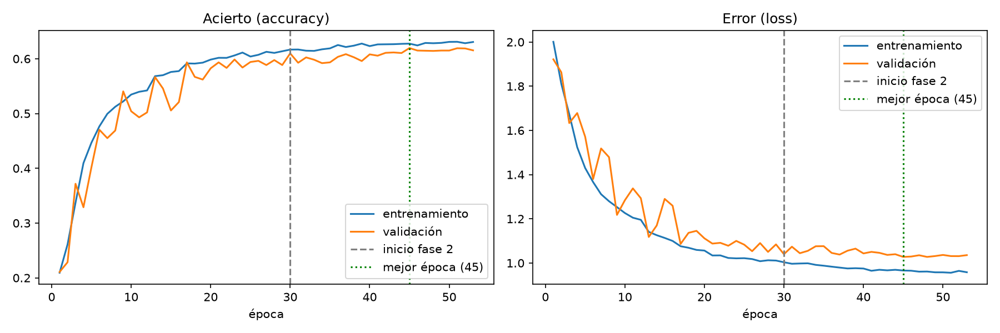
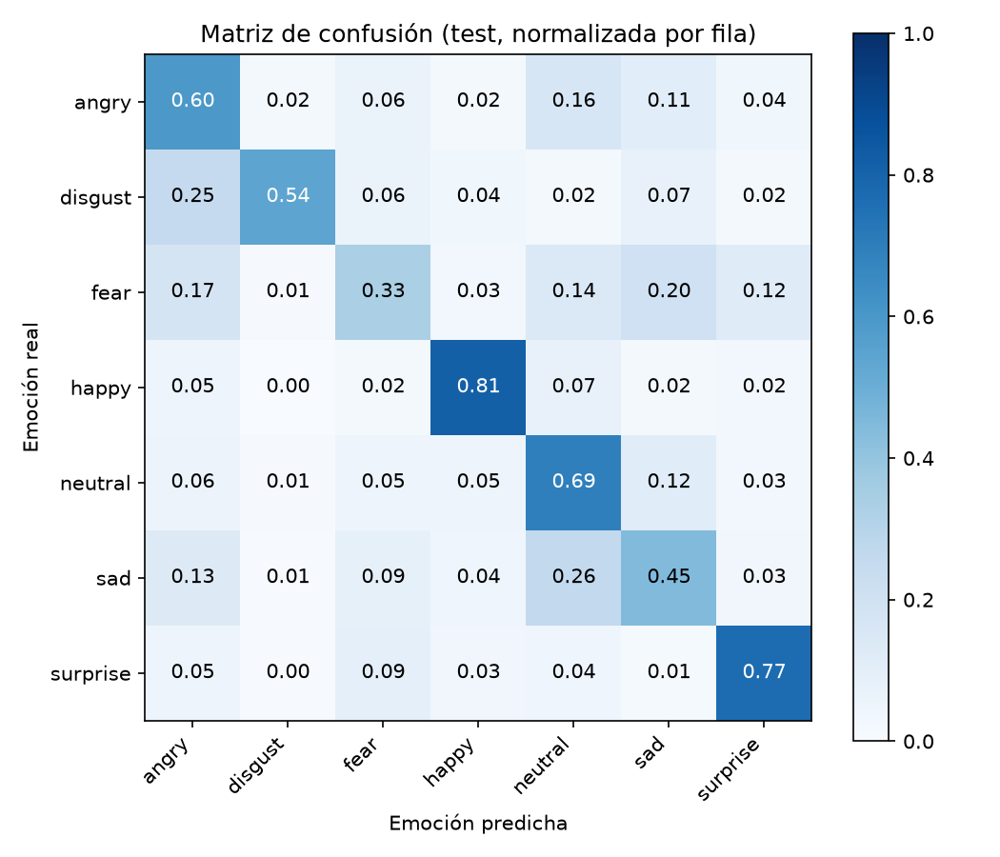
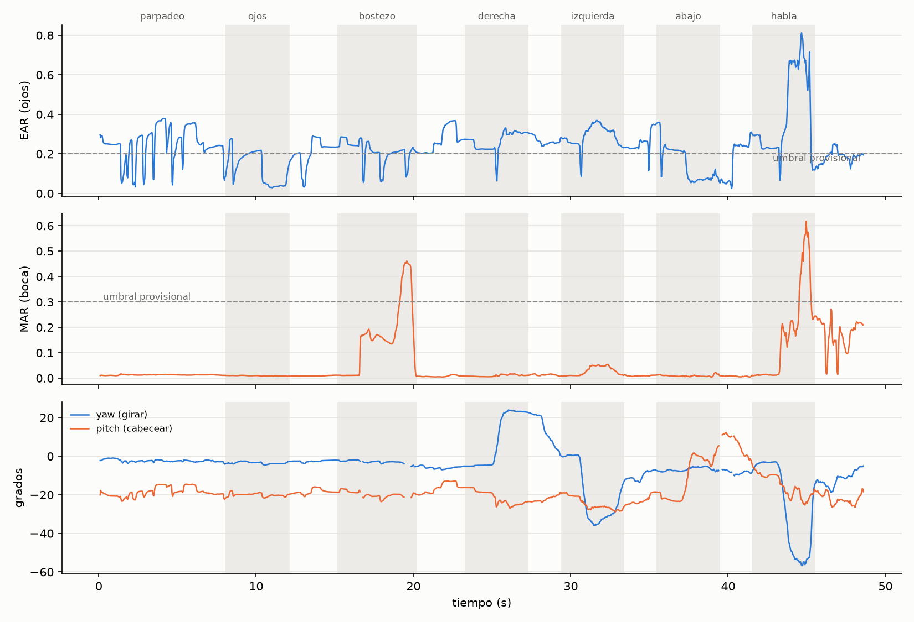
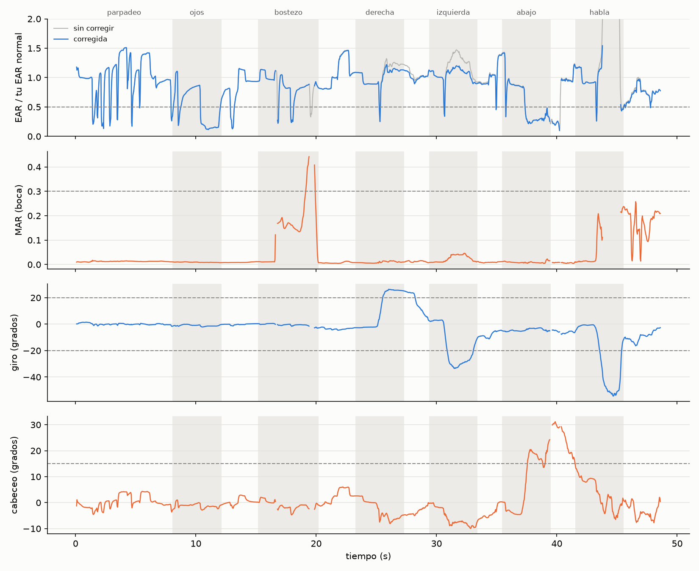
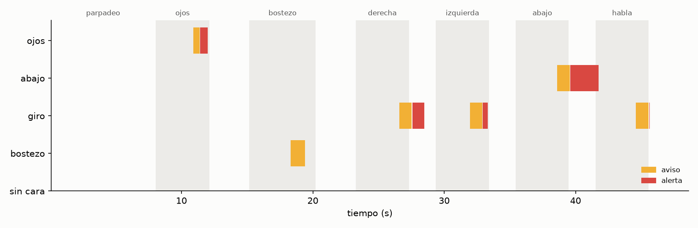
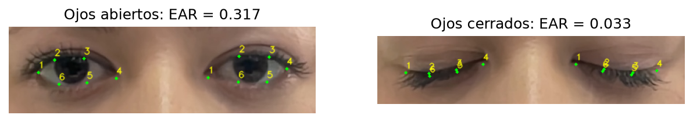
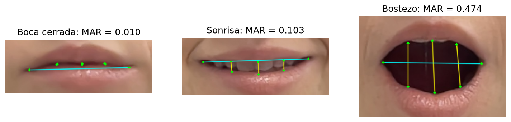
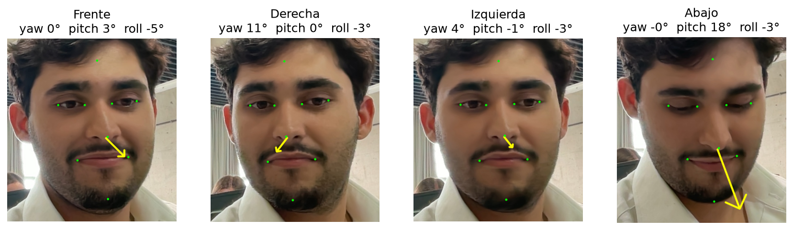

# Práctica 5: Biometría facial. Documentación

Autora 1: [Solmaire Basulto Santana](https://github.com/solbs365)  
Autor 2: [Gerad Leopoldo Guzmán Hernández](https://github.com/gerad367)

---

### 1. Descripción del Trabajo
Este repositorio contiene los dos cuadernos Jupyter y el código de los dos prototipos de la quinta práctica de Visión por Computador. El objetivo ha sido extraer información del rostro (expresión, landmarks, orientación de la cabeza) y usarla para provocar una *reacción* en una aplicación que funciona en directo con la webcam.

Se han desarrollado dos prototipos:

- **Prototipo A: «Reto no te rías».** Un juego que enseña memes mientras la cámara vigila la cara. Un modelo de emociones **entrenado en esta práctica** con FER2013 estima la probabilidad de risa y, si se te escapa, pierdes.
- **Prototipo B: Monitor de atención del conductor.** Un sistema que avisa cuando el conductor parece somnoliento o distraído (ojos cerrados, cabeza hacia abajo, mirada a otro lado, bostezo o cara fuera de cámara). No entrena ningún modelo: calcula señales a partir de los landmarks de MediaPipe y las calibra con la cara de cada persona.

**Escenarios de aplicación**

| Prototipo | Escenario | Reacción |
| :--- | :--- | :--- |
| A | Entretenimiento: juego social en el que gana quien aguanta más tiempo sin reírse. | Medidor de risa, pantalla de derrota con el meme que ha hecho reír y contador de memes. |
| B | Seguridad vial: detectar a tiempo la somnolencia y la distracción de quien conduce. | Estado ATENTO / AVISO / ALERTA con el motivo, alarma sonora y registro de eventos. |


### 2. Paquetes necesarios
Se ha trabajado en un environment nuevo, `VC_P5`, con Python 3.11 (TensorFlow 2.21.0 y OpenCV 4.12.0):

```
conda create --name VC_P5 python=3.11
conda activate VC_P5
pip install tensorflow mediapipe opencv-python numpy matplotlib scikit-learn
```

Además:

- `modelos/face_landmarker.task` es el modelo de MediaPipe para los 478 landmarks de la cara (ya está en el repositorio).
- La alarma del monitor usa `afplay`, que solo existe en macOS. En otros sistemas el programa funciona igual pero sin sonido.
- El dataset FER2013 **no se incluye** (pesa unos 140 MB). Para repetir el entrenamiento hay que descargarlo de [Kaggle](https://www.kaggle.com/datasets/msambare/fer2013) y dejarlo en una carpeta `fer2013/` con las subcarpetas `train/` y `test/` junto a los cuadernos.

### 3. Análisis y Resolución de Tareas

#### Prototipo A: «Reto no te rías»

**Dataset.** Se ha usado FER2013: imágenes de caras en gris de 48×48 píxeles con 7 emociones. El conjunto ya viene separado en entrenamiento y test; del entrenamiento se reserva un 10 % para validación (semilla fija, para que el reparto sea siempre el mismo).

| Clase | angry | disgust | fear | happy | neutral | sad | surprise | Total |
| :--- | :---: | :---: | :---: | :---: | :---: | :---: | :---: | :---: |
| Entrenamiento | 3995 | 436 | 4097 | 7215 | 4965 | 4830 | 3171 | 28709 |
| Test | 958 | 111 | 1024 | 1774 | 1233 | 1247 | 831 | 7178 |

El conjunto está muy desbalanceado: *disgust* tiene unas nueve veces menos imágenes que *fear* o *angry*. Para que la red no lo ignore se han usado pesos por clase (los de `balanced` suavizados con raíz cuadrada), de forma que un error en una clase rara cuesta más en la función de pérdida.

**Modelo.** Es una CNN propia, sin ningún modelo preentrenado, con 1.242.919 parámetros:

- 4 bloques de 2 convoluciones 3×3 + `BatchNormalization` + ReLU, seguidos de `MaxPooling` y `Dropout(0.25)`, con 32, 64, 128 y 256 filtros.
- `GlobalAveragePooling`, una capa densa de 256 neuronas con `BatchNormalization` y `Dropout(0.5)`, y una salida softmax de 7 clases.
- Aumento de datos solo durante el entrenamiento: giro horizontal, rotación, zoom y traslación pequeños.

**Entrenamiento.** Adam con tasa 1e-3, `ReduceLROnPlateau`, `EarlyStopping` (paciencia 8, recupera los mejores pesos) y `ModelCheckpoint`. Se hizo en dos fases: 30 épocas (43,5 min) y después se continuó el entrenamiento desde la época 30 hasta un máximo de 70 (32,2 min). El `EarlyStopping` lo paró en la época 53, y la mejor fue la **45** (val_loss 1,0275; val_accuracy 0,6195).

| Curvas de entrenamiento | Matriz de confusión (test) |
| :---: | :---: |
|  |  |

**Resultados en test** (7178 imágenes que la red no ha visto): **accuracy 0,622** y pérdida 1,019.

| Clase | Precision | Recall | F1 | Imágenes |
| :--- | :---: | :---: | :---: | :---: |
| angry | 0.503 | 0.596 | 0.545 | 958 |
| disgust | 0.500 | 0.541 | 0.519 | 111 |
| fear | 0.495 | 0.332 | 0.397 | 1024 |
| happy | 0.883 | 0.814 | 0.847 | 1774 |
| neutral | 0.524 | 0.692 | 0.596 | 1233 |
| sad | 0.527 | 0.445 | 0.483 | 1247 |
| surprise | 0.696 | 0.769 | 0.731 | 831 |
| Media macro | 0.590 | 0.598 | 0.588 | 7178 |

*Discusión.* Las clases con una expresión muy marcada salen mejor: *happy* (F1 0,847, la mejor, y además la que más imágenes tiene) y *surprise* (0,731). Las peores son *fear* (recall 0,33, se confunde sobre todo con *sad* en un 20 %, con *angry* en un 17 % y con *neutral* en un 14 %) y *sad* (se confunde con *neutral* en un 26 %). *Disgust* se confunde con *angry* en un 25 % de los casos, con solo 111 imágenes de test. Es un resultado razonable para FER2013, un dataset con etiquetas ruidosas y caras muy variadas: en la literatura se estima que una persona acierta alrededor del 65 % de las veces [Goodfellow13]. Para el juego, además, solo importa distinguir bien *happy*, que es la clase en la que el modelo es más fiable.

**Cómo funciona el juego** (`codigo/reto_no_te_rias.py`):

1. MediaPipe detecta la cara y devuelve sus 478 landmarks.
2. Con los landmarks de los ojos se **alinea** la cara (se gira hasta que los ojos quedan horizontales), se recorta un cuadrado alrededor de ella, se pasa a gris y se reduce a 48×48, el mismo formato con el que se entrenó el modelo.
3. La CNN devuelve la probabilidad de cada emoción. La de *happy* se **suaviza** con una media móvil exponencial (peso 0,7 al pasado) para que un solo fotograma raro no te haga perder.
4. Un medidor de risa sube 2,0 por segundo mientras la probabilidad suavizada sea ≥ 0,5 y baja 1,0 por segundo en caso contrario. Si llega a 1, pierdes.
5. Hay una cuenta atrás de 3 s, cada meme se muestra 6 s, y también se pierde si sales de cámara más de 2 s. Al terminar se enseña cuánto has aguantado y qué meme te ha hecho reír más veces.

Teclas: `ESC` para salir.

*Limitaciones.* El modelo se entrenó con fotos de FER2013 y se usa con una webcam: la iluminación, la resolución y el encuadre son distintos y el acierto real puede ser menor que el 62 % de test. Además, distingue *happy* de una sonrisa o de una risa sin más, no mide la intensidad.

#### Prototipo B: Monitor de atención del conductor

**Señales.** A partir de los landmarks de MediaPipe se calculan cinco señales por fotograma:

| Señal | Cómo se calcula |
| :--- | :--- |
| EAR (apertura del ojo) | `(‖p2 − p6‖ + ‖p3 − p5‖) / (2·‖p1 − p4‖)` con los 6 puntos de cada ojo, promediando los dos ojos [Soukupova16] |
| MAR (apertura de la boca) | `(‖p81 − p178‖ + ‖p13 − p14‖ + ‖p311 − p402‖) / (3·‖p78 − p308‖)` con puntos del labio interior |
| Giro (yaw), cabeceo (pitch) y ladeo (roll) | `cv2.solvePnP` con 9 landmarks (nariz, barbilla, esquinas de los ojos y de la boca, frente) y un modelo 3D genérico de cara |

**Calibración por persona.** Cada cara es distinta (hay ojos más pequeños, cámaras colocadas más arriba...), así que no se usan valores fijos. Durante los 8 primeros segundos, mirando al frente, se toma la mediana de cada señal como la «cara normal» de esa persona, y todo se mide respecto a ella: `EAR_rel = EAR·cos(yaw) / EAR_normal` (el coseno corrige que el ojo parece más pequeño al girar), `yaw_rel` y `pitch_rel` como diferencia con la postura normal. Cuando el giro supera 40° el EAR y el MAR se descartan, porque con la cara de perfil dejan de ser fiables.

**Reglas.** Cada regla se activa cuando su condición se cumple de forma continua durante un tiempo, lo que evita que un parpadeo o un movimiento rápido disparen una alarma. Un pequeño hueco de datos no reinicia la cuenta.

| Regla | Condición | AVISO | ALERTA | Hueco tolerado |
| :--- | :--- | :---: | :---: | :---: |
| ojos | `EAR_rel < 0.5` y no se mira hacia abajo | 0,5 s | 1,0 s | 0 s |
| abajo | `pitch_rel > 15°` | 1,0 s | 2,0 s | 0,3 s |
| giro | `\|yaw_rel\| > 20°` | 1,0 s | 2,0 s | 0,3 s |
| bostezo | `MAR > 0.15` (se da por terminado por debajo de ≈ 0.10) | 1,5 s | no tiene | 0 s |
| sin cara | no se detecta la cara | 1,0 s | 2,0 s | 0 s |

Con la cabeza hacia abajo el párpado cae y el EAR baja aunque los ojos estén abiertos, por eso en ese caso la regla de los ojos no cuenta. El bostezo solo llega a AVISO, porque un bostezo aislado no es una emergencia.

**Validación con un clip.** Se grabó un clip de 48 s (1363 fotogramas, 28 fps) siguiendo un guion con pitidos: parpadeo normal, ojos cerrados, bostezo, giro a la derecha, giro a la izquierda, mirar abajo y hablar. La cara se detectó en el 100 % de los fotogramas. Las alertas que dio el sistema son estas:

| Acción del guion | Alertas del monitor |
| :--- | :--- |
| Parpadeo normal (0 a 8 s) | Ninguna: hay 8 episodios de ojo cerrado, todos de 0,2 s o menos (parpadeos) |
| Ojos cerrados | AVISO a los 10,9 s y ALERTA a los 11,4 s |
| Bostezo | AVISO a los 18,3 s |
| Giro a la derecha | AVISO a los 26,6 s y ALERTA a los 27,6 s |
| Giro a la izquierda | AVISO a los 32,0 s y ALERTA a los 32,9 s |
| Mirar abajo | AVISO a los 38,6 s y ALERTA a los 39,6 s |
| Hablar | AVISO de giro a los 44,6 s (ALERTA de solo 0,1 s): es una **falsa alarma** |

El retraso de unos segundos entre el inicio de cada tramo del guion y la alerta es el tiempo que tarda la persona en reaccionar al pitido y mantener el gesto el tiempo que exige la regla.

| Señales del clip | Señales normalizadas | Alertas |
| :---: | :---: | :---: |
|  |  |  |

**Las señales sobre fotos de prueba.** Para ver que las señales miden lo que deben, se calcularon sobre fotos hechas con la cámara, con los puntos de MediaPipe dibujados encima.



*EAR.* Con los ojos abiertos vale 0,317 y con los cerrados 0,033, porque los puntos de arriba y de abajo de cada párpado (2, 3, 5 y 6) casi se juntan.



*MAR.* Boca cerrada 0,010, sonrisa 0,103 y bostezo 0,474. La sonrisa queda por debajo del umbral de 0,15, así que sonreír no cuenta como bostezo.



*Pose de la cabeza.* La flecha amarilla marca hacia dónde apunta la nariz. De frente el cabeceo (*pitch*) es de 3° y mirando abajo sube a 18°. En estas fotos el giro (*yaw*) es pequeño, de 11° como máximo.

**En directo** (`codigo/monitor_conductor.py`). El monitor hace lo mismo que el análisis del clip, pero fotograma a fotograma y mirando solo al pasado, que es lo único que existe con la cámara. Se comprobó que, reproduciendo el clip por el monitor, salen exactamente las mismas alertas que en el análisis completo (0 fotogramas distintos en las cinco reglas). La pantalla muestra una banda ATENTO / AVISO / ALERTA, el estado de cada regla y los valores relativos a la cara normal; suena una alarma (que se repite cada 1,5 s en ALERTA) y cada cambio se apunta en `resultados/registro_monitor.csv`. Teclas: `c` calibrar otra vez, `m` sonido sí/no, `ESC` o `q` salir. Con `--grabar` se guarda también el vídeo de la sesión. Si la calibración falla (no se ve la cara, los ojos están cerrados o se mira de lado) el programa lo dice y la repite.

**Robustez.** Para comprobar cuánto aguanta el monitor fuera de las condiciones ideales se hizo una sesión guiada de unos 45 s por condición (`codigo/robustez.py`): 8 s de calibración, 7 s sin hacer nada raro (aquí se cuentan las **falsas alarmas**) y un guion con pitidos para cerrar los ojos, girar, mirar abajo y bostezar. La columna `cara_%` es el porcentaje de fotogramas con cara detectada y un guion bajo (`-`) significa que ni siquiera se pudo calibrar.

| Condición | FPS | Cara detectada | Falsas alarmas | Ojos | Giro | Abajo | Bostezo |
| :--- | :---: | :---: | :---: | :---: | :---: | :---: | :---: |
| Normal (de frente, buena luz) | 16 | 100 % | 0 | sí | sí | no | sí |
| Poca luz | 16 | 98 % | — | — | — | — | — |
| Lejos de la cámara | 29 | 0 % | — | — | — | — | — |
| Con gafas | 22 | 95 % | 0 | sí | sí | no | no |
| Cabeza ladeada | 17 | 100 % | 0 | sí | no | sí | no |

*Lo que se ve en la tabla:*

- **No da falsas alarmas** en ninguna de las tres condiciones en las que llega a calibrarse, y la regla de los **ojos** funciona en las tres.
- **Poca luz y lejos: el monitor no llega ni a calibrarse.** Es el límite del detector de caras, no de las reglas. En poca luz la cara se veía en el 98 % de los fotogramas, pero la orientación de la cabeza no salía bien y la calibración falló. Lejos, el detector no encontró la cara en ningún fotograma. Se comprobó con una simulación sobre el clip: si se reduce la cara a la mitad (≈ 9 % del ancho de la imagen) se sigue detectando, pero al reducirla al 35 % (≈ 6 %) se pierde por completo, y un ruido fuerte en la imagen, como el de una webcam en la oscuridad, también hace que deje de detectarla. Aclarar la imagen o bajar la exigencia del detector no mejoró el resultado.
- **Mirar abajo y bostezar** solo se detectaron en parte de las sesiones (abajo en 1 de 3, bostezo en 1 de 3). En el clip de validación, con gestos más marcados, sí saltaron. Es probable que en estas pruebas el gesto fuera más suave o corto de lo que exigen las reglas (más de 15° durante 1 s, boca muy abierta 1,5 s), pero no se guardó qué valor se alcanzó, así que no se puede asegurar. Queda como mejora bajar ese umbral y registrar el máximo alcanzado en cada prueba.
- Con la **cabeza ladeada** el giro no llegó a detectarse.
- Las **gafas** no impidieron detectar la cara (95 %) ni los ojos cerrados.

*Limitaciones.*

- Los umbrales se ajustaron con un único clip, de una persona y una cámara.
- Con un giro de más de 40° el EAR y el MAR se descartan.
- Reírse con la boca muy abierta durante más de 1,5 s podría confundirse con un bostezo.
- Hablar moviendo la cabeza puede disparar la regla del giro (ocurrió una vez en el clip).
- El detector de caras es el límite de todo lo demás: si no ve la cara (poca luz, muy lejos) no hay señal que analizar.
- Los gestos suaves (una mirada rápida hacia abajo, un bostezo corto) pueden no alcanzar las condiciones de las reglas.


### 4. Demostración

https://github.com/user-attachments/assets/a355ad16-f369-4480-a37d-9cd3f10cd34b

*Prototipo A (juego «no te rías») y prototipo B (monitor del conductor), 22 s.*


### 5. Estructura del repositorio y ejecución

```
Practica5_VC/
├── VC_P5_Tarea1.ipynb        Prototipo A: dataset, entrenamiento y evaluación de la CNN de emociones
├── VC_P5_Tarea2.ipynb        Prototipo B: señales, calibración, reglas, validación y robustez
├── codigo/
│   ├── reto_no_te_rias.py    Prototipo A (juego en directo)
│   ├── monitor_conductor.py  Prototipo B (monitor en directo)
│   └── robustez.py           Pruebas de robustez del prototipo B
├── modelos/                  emociones.keras (CNN entrenada) y face_landmarker.task (MediaPipe)
├── resultados/               historiales de entrenamiento, métricas, clip de prueba, registros y vídeo de la demostración
├── img/                      figuras de este README
└── contenido/                memes del juego
```

Desde la carpeta `Practica5_VC` y con el environment activado:

```
conda activate VC_P5
python codigo/reto_no_te_rias.py                  # prototipo A (ESC para salir)
python codigo/monitor_conductor.py                # prototipo B (ESC o q para salir)
python codigo/monitor_conductor.py --grabar resultados/demo_monitor.mp4
python codigo/robustez.py "poca luz"              # una prueba de robustez
```

Ambos programas abren la webcam; la primera vez macOS pide permiso de cámara. El cuaderno de la tarea 1 **no vuelve a entrenar** si ya existe `modelos/emociones.keras` (el entrenamiento tarda más de una hora): para repetirlo hay que renombrar ese archivo y tener el dataset descargado. El cuaderno de la tarea 2 reutiliza las fotos de `fotos_prueba/` y el clip de `resultados/` si existen y, si no, los vuelve a grabar con la cámara. Esa carpeta de fotos no se sube al repositorio.

Los memes de `contenido/` proceden de internet y se usan solo con fines académicos; su autoría es de sus creadores.


### 6. Bibliografía y Fuentes Consultadas

- [Goodfellow13] I. Goodfellow et al. [Challenges in Representation Learning: A report on three machine learning contests](https://arxiv.org/abs/1307.0414). Neural Networks, 2013. (Origen del dataset FER2013)
- [FER2013 en Kaggle](https://www.kaggle.com/datasets/msambare/fer2013)
- [Soukupova16] T. Soukupová y J. Čech. [Real-Time Eye Blink Detection using Facial Landmarks](https://vision.fe.uni-lj.si/cvww2016/proceedings/papers/05.pdf). CVWW, 2016. (Definición del EAR)
- [MediaPipe Face Landmarker](https://ai.google.dev/edge/mediapipe/solutions/vision/face_landmarker)
- [OpenCV: Perspective-n-Point (solvePnP)](https://docs.opencv.org/4.x/d5/d1f/calib3d_solvePnP.html)
- [Keras: API reference](https://keras.io/api/)
- [scikit-learn: Metrics and scoring](https://scikit-learn.org/stable/modules/model_evaluation.html)
